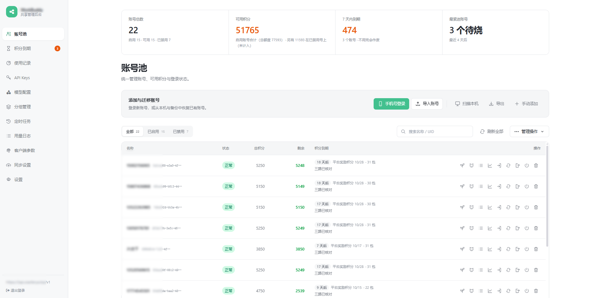
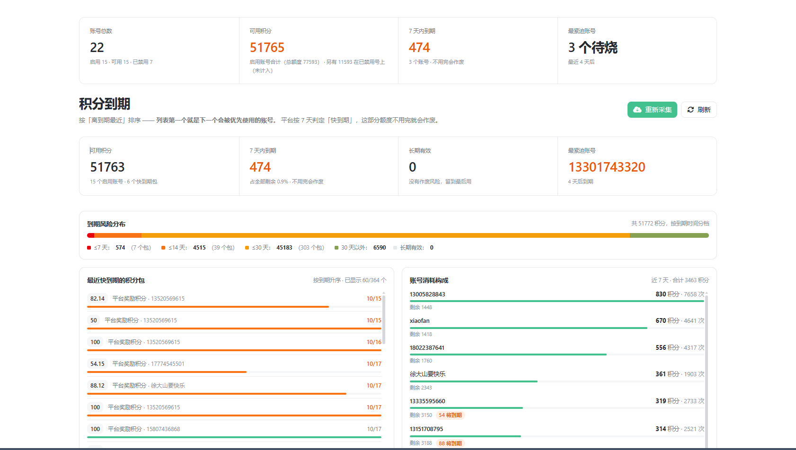
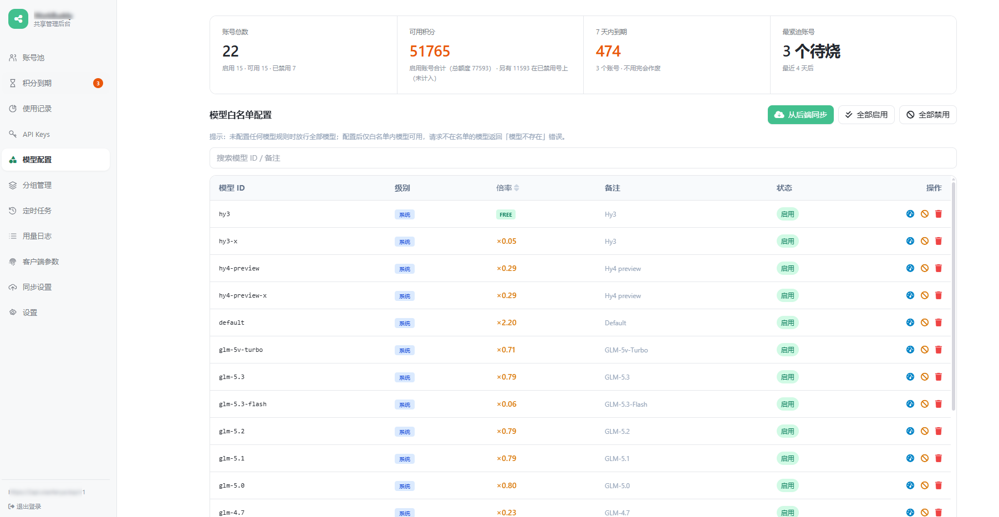
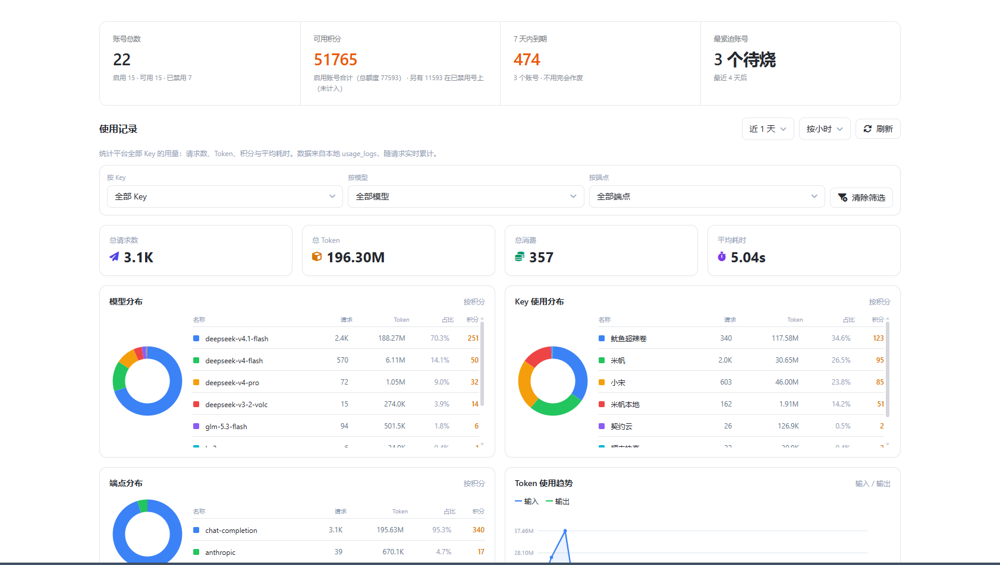
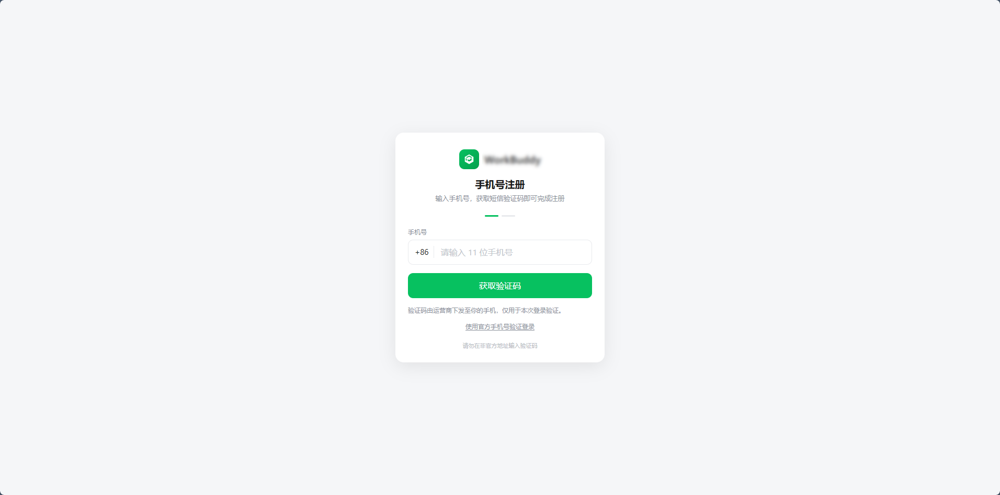

# workbuddy2api

把 WorkBuddy / CodeBuddy 登录态接入 OpenAI、Responses 和 Anthropic 兼容 API，提供多账号池、API Key 和自动化管理界面。

## 项目运行截图



## 模块说明

| 模块 | 功能 |
| --- | --- |
| 账号池 | 手机号登录、备份导入、余额与积分到期快照、账号冷却和健康状态 |
| API Keys | 创建访问密钥、配置配额与分组、选择并复制本机或局域网 API 地址 |
| 模型配置 | 同步模型、批量启停、配置模型列表名称中的倍率和繁忙程度、检测延迟与抖动 |
| 自动化任务 | 签到、成长计划、旅行及奖励领取；完成后刷新余额和到期快照 |
| 使用记录 | 按 Key、账号和模型查询调用结果、耗时与错误 |
| 本地客户端 | Windows EXE、Android APK 自动进入工作台，启动检查更新并展示公告，可稍后处理 |

<details>
<summary>查看更多运行截图</summary>






</details>

## Windows 与 Android

从 [GitHub Releases](https://github.com/xiaofan6ya/workbuddy2api/releases) 下载对应平台安装包及 SHA256 校验文件。

| 平台 | 使用方式 | 详细说明 |
| --- | --- | --- |
| Windows x64 | 下载 EXE 后直接运行，内置 Python 与项目依赖 | [桌面版说明](desktop/README.md) |
| Android ARM64 | 安装 APK，在手机上独立运行后端和 SQLite | [安卓版说明](android/README.md) |

本地应用无需输入后台账号密码。服务监听 `0.0.0.0`，同机使用 `127.0.0.1`，其他设备使用局域网地址；在 **API Keys → 连接地址** 选择检测到的 IP，即可复制相应 API 地址。端口冲突时客户端会选择可用端口并保存。远程浏览器访问管理页仍需要后台登录，调用 API 仍需要 Key。

发现新版本时弹出更新公告，可选择“稍后再说”或“暂不更新此版本”。右上角更新入口和左下角版本号随时可以重新打开公告、下载最新版。Windows 校验下载文件后由用户确认重启安装；Android 下载 APK 后通过系统安装器覆盖安装，同签名升级保留数据。

Android 后台稳定运行需要允许通知、后台运行及取消电池优化。设置页可检查服务、授权、电池和后台限制状态；系统强行停止应用后仍需重新打开。

新版 Windows 官方客户端导出的加密原始 `.info` 无法直接在未配置解密密钥的安卓端解密。迁移时请在电脑账号管理页选择导出“系统明文备份”，或在手机使用手机号登录和 `/join` 授权。明文备份包含账号凭证，请妥善保管。

## Linux Docker 部署

安装 Docker Engine 和 Compose 插件后执行：

```bash
git clone https://github.com/xiaofan6ya/workbuddy2api.git
cd workbuddy2api
umask 077
printf 'ADMIN_USERNAME=admin\nADMIN_PASSWORD=%s\nADMIN_JWT_SECRET=%s\n' "$(openssl rand -hex 16)" "$(openssl rand -hex 32)" > .env.docker
cat .env.docker  # 查看并保存自动生成的后台密码
docker compose --env-file .env.docker up -d --build
docker compose --env-file .env.docker ps
docker compose --env-file .env.docker logs --tail=100 admin
```

访问 `http://服务器IP:8790/admin`，使用 `.env.docker` 的用户名和密码登录。放行 TCP 8790；公网部署建议配置 HTTPS 反向代理。

默认只运行 **一个 admin 容器**，包含 Web UI、多账号网关与定时任务。SQLite 保存在 `admin_data` 命名卷，限流使用进程内存，无需另装 MySQL 或 Redis。保持单 worker，使账号租约、短信出口限流与调度任务共享状态。

Compose 中的 `converter` 是可选的单账号转换器，已放入 `standalone` profile，admin 不依赖它。只有需要独立读取宿主机 `credentials/` 凭证目录时，才配置 `CODEBUDDY2OPENAI_KEY`，并执行：

```bash
docker compose --env-file .env.docker --profile standalone up -d --build
```

升级执行 `git pull`，再执行 `up -d --build`。`docker compose down` 保留数据，**不要添加 `-v`**。旧版 MySQL 数据不会自动迁入 SQLite；迁移前先备份。沿用 MySQL 时用 Compose override 覆盖 `ADMIN_DATABASE_URL`，地址须从容器内可达。

备份 SQLite：

```bash
docker compose --env-file .env.docker stop admin
docker compose --env-file .env.docker cp admin:/data/workbuddy.db ./workbuddy-backup.db
docker compose --env-file .env.docker start admin
```

容器内检测到的 IP 可能属于 Docker 网桥。远程接入优先使用浏览器当前访问的服务器地址及映射端口；需要局域网访问时填写宿主机 IP。

## 源码运行

需要 Python 3.10 或更高版本：

```bash
python -m venv .venv
# Linux/macOS
source .venv/bin/activate
# Windows PowerShell 则执行 .venv\Scripts\Activate.ps1
python -m pip install -r requirements.txt
cp .env.example .env
```

编辑 `.env`，设置 `ADMIN_USERNAME`、`ADMIN_PASSWORD` 和随机的 `ADMIN_JWT_SECRET`。模板保留 MySQL/Redis 配置；单机 SQLite 可改为：

```dotenv
ADMIN_DATABASE_URL=sqlite:///./workbuddy_admin.db
ADMIN_REDIS_URL=
ADMIN_GATEWAY_LIMIT_BACKEND=memory
```

```bash
python -m uvicorn admin.server:app --host 0.0.0.0 --port 8790
```

打开 `http://127.0.0.1:8790/admin`。Web 部署需要管理账号登录。添加账号后自动刷新余额与到期快照；手机号支持中国大陆 `+86`、中国香港 `+852`、中国澳门 `+853`。等待验证码时保留会话，遵守发送倒计时。

## API 接入

在 API Keys 页创建密钥并选择连接地址。两类 SDK 的 Base URL 约定不同：

| 协议 | Base URL 示例 | 请求路径 |
| --- | --- | --- |
| OpenAI Chat / Responses | `http://127.0.0.1:8790/v1` | `/v1/chat/completions`、`/v1/responses` |
| Anthropic Messages | `http://127.0.0.1:8790` | `/v1/messages` |

OpenAI 使用 `Authorization: Bearer <API Key>`；Anthropic 可使用 `x-api-key`。启用模型通过 `GET /v1/models` 获取。模型配置中的“显示倍率”和“显示繁忙程度”分别控制接口返回的 `name`，例如 `model-id · ×1.25 · 空闲`；关闭后不拼接对应部分，模型 `id` 保持不变。管理表格仍显示完整状态。

模型检测会发送实际的短请求，展示响应头耗时、首字延迟、片段间隔抖动和当次健康状态，会消耗少量额度；结果代表检测时的账号与网络状况。

## 文档与构建

- [协议逆向、实现说明与历史排障报告](docs/protocol-reference.md)
- [账号调度、出口风险与维护任务加固](docs/2api-increment-risk-scheduling.md)
- [EXE / APK 构建与发布](BUILD.md)：根目录 `build.bat` 可统一构建两端
- [通用工具脚本](scripts/README.md)：守护进程、凭证配置与 ASAR 工具
- [1.0.3 更新公告](RELEASE_NOTES_1.0.3.md)

## 协议与致谢

本项目使用 [MIT License](LICENSE)，与腾讯、WorkBuddy、CodeBuddy、OpenAI、Anthropic 无官方关联。

思路与设计参考：[HanHan666666/codebuddy2openai](https://github.com/HanHan666666/codebuddy2openai)、[Sliverkiss/workbuddy2api](https://github.com/Sliverkiss/workbuddy2api)、[linguo2625469/workbuddy2api-panel](https://github.com/linguo2625469/workbuddy2api-panel)。引用范围与历史说明见技术文档。

项目早期代码和文档由 [DeepSeek](https://platform.deepseek.com) 与 [DSH](https://github.com/deepseek-ai/deepseek-harness) 协助完成。
